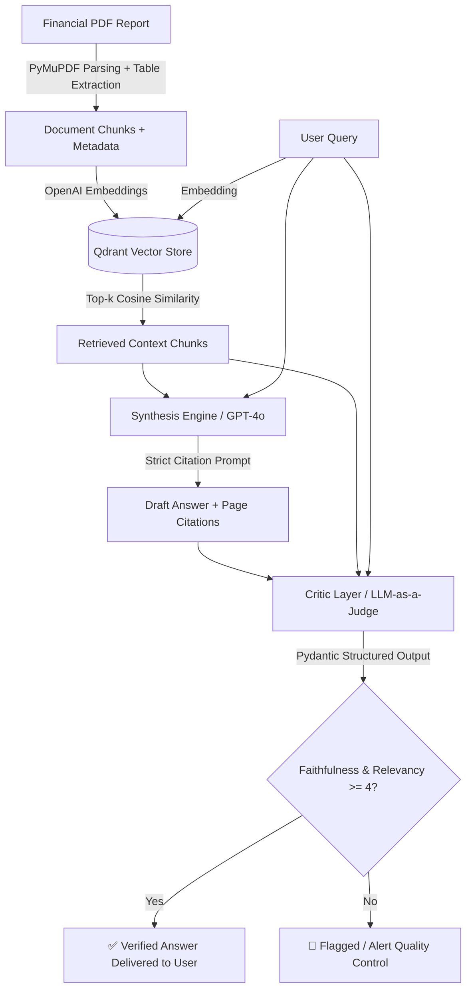

# Multimodal Enterprise RAG (Retrieval-Augmented Generation)

[](https://www.python.org/downloads/)
[](https://platform.openai.com/)
[](https://qdrant.tech/)
[](https://pymupdf.readthedocs.io/)
[](https://docs.pydantic.dev/)

An enterprise-grade, production-ready Retrieval-Augmented Generation (RAG) platform tailored for financial document parsing, tabular data extraction, strict citation attribution, and automated quality assurance using an **LLM-as-a-Judge Critic layer**.

---

## 🏛️ System Architecture



---

## 📂 Repository Structure

```
multimodal-enterprise-rag/
├── src/
│   ├── __init__.py            # Module exports
│   ├── parser.py              # PyMuPDF ingestion, table detection, and page metadata
│   ├── vector_store.py        # Qdrant client & OpenAI embedding management
│   ├── generator.py           # Synthesis engine with strict grounding & page citations
│   └── evaluator.py           # Critic layer (LLM-as-a-Judge with Pydantic structured output)
├── data/
│   ├── create_sample_pdf.py   # Synthetic 4-page financial report generator
│   └── sample_report.pdf      # Sample Q3 shareholder report with tables
├── tests/
│   └── test_pipeline.py       # Comprehensive unit & integration test suite
├── .github/
│   └── workflows/
│       └── ci.yml             # GitHub Actions CI matrix for Python 3.10-3.13
├── .env.example               # Configuration template
├── main.py                    # End-to-end orchestration CLI with Rich UI
├── pyproject.toml             # Packaging & project metadata configuration
├── requirements.txt           # Production dependencies
└── README.md                  # System documentation
```

---

## 🚀 Key Features

1. **Precision Page-Level Attribution (`src/parser.py`)**:
   - Parses multi-page complex financial PDFs using PyMuPDF (`fitz`).
   - Automatically detects structured tables and serializes them into clean Markdown format.
   - Preserves exact 1-indexed `page_number`, `source_file`, and character offsets for every chunk.

2. **Hybrid & In-Memory Vector Search (`src/vector_store.py`)**:
   - Vectorization with OpenAI `text-embedding-3-small` (1536 dimensions).
   - Embedded in-memory Qdrant engine (`:memory:`) for fast zero-infrastructure testing or remote Qdrant cluster connections for production.

3. **Strict Citation Synthesis (`src/generator.py`)**:
   - GPT-4o prompt engineering strictly enforcing grounding in provided context.
   - Refusal trigger: responds *"I cannot find the answer in the provided documents."* if context is insufficient.
   - Automatic citation extraction format: `[Source: <filename>, Page: <page_number>]`.

4. **The "Critic" Layer / LLM-as-a-Judge (`src/evaluator.py`)**:
   - Evaluates generated answers before user delivery using Pydantic structured outputs (`client.beta.chat.completions.parse`).
   - **Faithfulness (1-5)**: Measures absence of hallucinations and strict grounding in context.
   - **Relevancy (1-5)**: Measures direct alignment with the user's inquiry.
   - **Automated Flagging**: Flags any response scoring `< 4` on either metric.

---

## ⚙️ Quickstart & Installation

### 1. Clone & Setup Virtual Environment
```bash
git clone https://github.com/Aanshmita/multimodal-enterprise-rag.git
cd multimodal-enterprise-rag

python -m venv venv
# On Windows:
.\venv\Scripts\activate
# On Linux/macOS:
source venv/bin/activate
```

### 2. Install Dependencies
```bash
pip install -r requirements.txt
```

### 3. Configure Environment Variables
Copy `.env.example` to `.env` and fill in your OpenAI API credentials:
```bash
cp .env.example .env
```
Edit `.env`:
```env
OPENAI_API_KEY=sk-...
OPENAI_EMBEDDING_MODEL=text-embedding-3-small
OPENAI_CHAT_MODEL=gpt-4o
QDRANT_URL=:memory:
```

### 4. Run the Pipeline
Execute the end-to-end pipeline on the sample quarterly report:
```bash
python main.py
```

To run with custom queries or documents:
```bash
python main.py --query "What was the revenue of AI Infrastructure & Hardware in Q3 2025?" --pdf data/sample_report.pdf
```

To run offline demonstration / mock mode (without consuming API credits):
```bash
python main.py --mock
```

---

## 📊 Sample Output Preview

```
⚡ MULTIMODAL ENTERPRISE RAG PIPELINE ⚡
Grounded Financial PDF Intelligence • Source Citations • LLM-as-a-Judge Critic

[1/4] Parsing PDF document: data/sample_report.pdf
✔ Ingested 6 chunks across all pages.

[2/4] Vectorizing & Indexing Chunks in Qdrant (In-Memory)...
✔ Successfully indexed 6 chunks into vector collection.

[3/4] Retrieving Top 3 Contexts for Query: 'What was the company's Q3 net revenue according to page 4?'

[4/4] Synthesizing Answer & Running Critic Evaluation...

╭─ 🤖 Synthesized Answer ────────────────────────────────────────────────────────╮
│ According to page 4, the company achieved Q3 Net Revenue of $4.82 billion       │
│ (an increase of $600 million or 14.2% YoY from $4.22 billion in Q3 2024).     │
│ [Source: sample_report.pdf, Page: 4]                                            │
╰─────────────────────────────────────────────────────────────────────────────────╯

┏━━━━━━━━━━━━━━━━━━━━━━━━━━━━┳━━━━━━━━━━━━━━┳━━━━━━━━━━━━━━━━━━━━━━━━━━━━━━━━━━━━━━━━━━━━━━━━━━━━━━━━━━━━━━┓
┃ Metric                     ┃ Score (1-5)  ┃ Assessment & Reasoning                                       ┃
┡━━━━━━━━━━━━━━━━━━━━━━━━━━━━╇━━━━━━━━━━━━━━╇━━━━━━━━━━━━━━━━━━━━━━━━━━━━━━━━━━━━━━━━━━━━━━━━━━━━━━━━━━━━━━┩
│ Faithfulness (Grounding)   │ 5/5          │ All financial figures and citations match source document.   │
│ Relevancy (Query Match)    │ 5/5          │ Directly and accurately addresses the Q3 net revenue query.  │
│ Final Status               │ ✅ APPROVED   │ Passed: Response is fully grounded and explicitly cited.     │
└────────────────────────────┴──────────────┴──────────────────────────────────────────────────────────────┘
```

---

## 🛡️ Quality & Safety Guarantees

| Metric | Target | Failure Action |
| :--- | :--- | :--- |
| **Faithfulness** | $\ge 4.0 / 5.0$ | Flagged for human auditor review / Rejected |
| **Relevancy** | $\ge 4.0 / 5.0$ | Flagged / Trigger secondary retrieval pass |
| **Citation Attribution** | 100% of factual statements | Re-prompting engine to attach page anchors |

---

## 📜 License
Apache-2.0 License. See [LICENSE](LICENSE) for details.